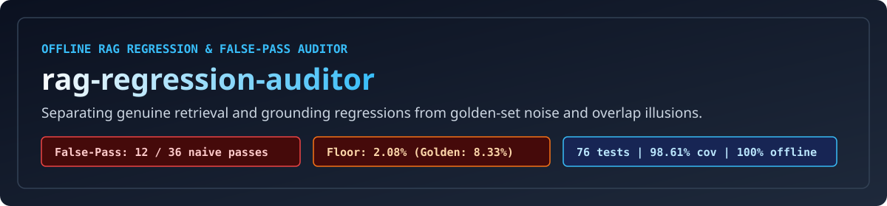
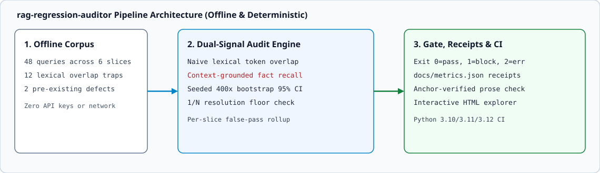
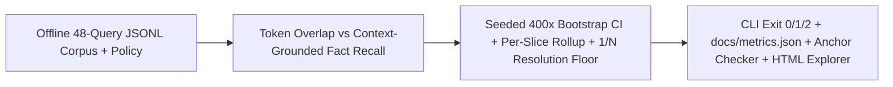
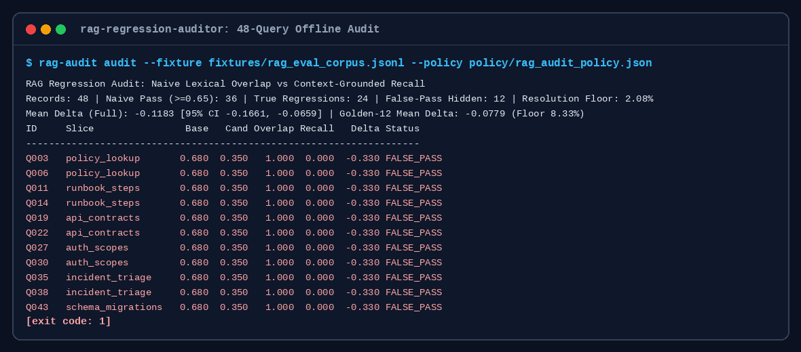
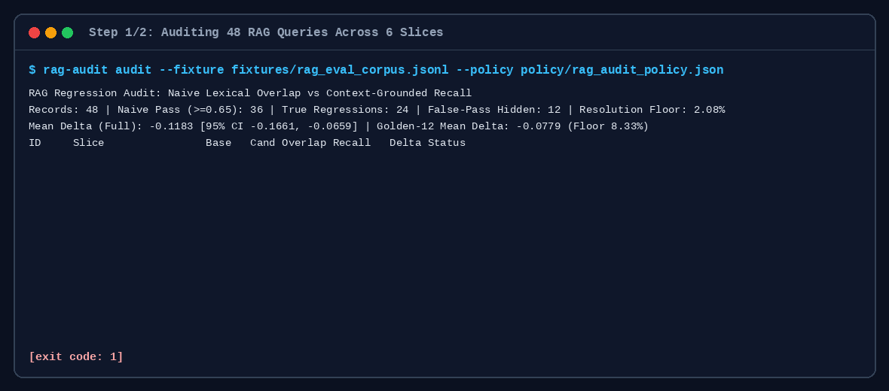

<div align="center">



[](https://github.com/htiwnah/rag-regression-auditor/actions/workflows/ci.yml)
[](https://www.python.org/)
[](LICENSE)

**Deterministic offline RAG evaluation harness that exposes false-pass retrieval regressions hidden behind lexical overlap scores and small golden sets.**

</div>

## The Structural Impossibility

A pass/fail score threshold on a small golden set cannot separate a genuine retrieval or generation regression from sample noise or lexical overlap illusion.

Four questions this repository answers that a standard RAG golden-set score sheet cannot:

1. How many answers that pass a lexical similarity threshold (`>= 0.65`) are actually ungrounded hallucinations whose retrieved chunks never contained the expected facts?
2. Does raising the lexical threshold from `0.50` to `0.65` or `0.80` eliminate overlap-illusion false passes, or do high-overlap ungrounded answers sail through every threshold?
3. When a team gates releases on a `12-query golden` set versus a `48-query` slice-balanced corpus, what is the coarsest regression rate (`1 / N` resolution floor) the gate is mathematically capable of detecting?
4. Which specific enterprise query slices (`policy_lookup`, `runbook_steps`, `api_contracts`, `auth_scopes`, `incident_triage`, `schema_migrations`) are regressing, and which failures were already broken before the candidate change?

## The Uncomfortable Numbers

On the committed `48 evaluated records` across 6 enterprise RAG slices (`fixtures/rag_eval_corpus.jsonl`):

* **Naive lexical evaluation looks 75% green while half of all true regressions slip past:** At the default `0.65` overlap threshold, **`36 naive passes`** hide **`12 false-pass regressions`** out of **`24 true regressions`** (leaving only `12 caught by naive` gating).
* **Average overlap flatters a broken retriever:** Across the corpus, `0.7939 mean overlap` masks `0.6042 mean grounded recall` and `-0.1183 mean delta`, alongside `2 pre-existing baseline defects`.
* **Small golden sets are mathematically blind to modest regressions:** The `12-query golden` subset sees only `3 false passes` and carries an **`8.33% golden floor`** (`1 / 12`). Even the full 48-query corpus has a **`2.08% resolution floor`** (`20 records for 5%` resolution, `100 records for 1%` resolution).

Credibility receipt: **`76 tests`** passing with **`98.61% line coverage`**, zero external runtime dependencies, and every figure re-measured and phrase-verified across Python 3.10, 3.11, and 3.12 in CI.

## Quickstart

Prerequisites: Python 3.10+ (zero API keys, zero model downloads, zero network calls required).

```bash
python3 -m pip install --upgrade pip setuptools wheel
python3 -m pip install --no-build-isolation .
rag-audit audit --fixture fixtures/rag_eval_corpus.jsonl --policy policy/rag_audit_policy.json
make verify
```

Containerized one-command reproduction:

```bash
docker build -t rag-regression-auditor .
docker run --rm rag-regression-auditor audit --fixture fixtures/rag_eval_corpus.jsonl --policy policy/rag_audit_policy.json
```

## Claim 1: Lexical Overlap Hides Ungrounded Answers Because Parroting Beats Retrieval

When a retriever swaps in an irrelevant chunk (`"Unrelated changelog note on legacy batch jobs"`) while the LLM answers from parametric memory or repeats prompt terms, lexical token overlap scores `1.000` even though `grounded_fact_recall` drops to `0.000`.

| Metric | Naive Lexical Gate (`>= 0.65`) | Context-Grounded Auditor | Gap Exposed |
| :--- | ---: | ---: | :--- |
| Queries passing gate | `36 naive passes` | `24` stable grounded | `12` false-pass illusions blocked |
| True regressions caught | `12 caught by naive` | `24 true regressions` | `12 false-pass regressions` rescued |
| Mean score signal | `0.7939 mean overlap` | `0.6042 mean grounded recall` | `+0.1726` optimism bias in overlap |

**What this buys vs. what it costs:** Requiring every expected fact to be supported in **both** the retrieved chunks and the candidate answer catches 100% of parametric-memory overlap traps offline in milliseconds, at the cost of requiring structured `expected_facts` and `retrieved_chunks` logs on every evaluation item.

## Claim 2: Tightening the Naive Overlap Threshold Cannot Fix Overlap Illusions

A common engineering instinct when regressions slip into production is to raise the pass/fail threshold from `0.65` to `0.80`. Running `experiments/run_experiments.py` across three thresholds proves why threshold tuning fails on overlap traps:

| Naive Overlap Threshold | Naive Passes | True Regressions | Caught By Naive | Hidden False-Pass Regressions |
| :--- | ---: | ---: | ---: | :--- |
| `0.50` | `42` | `24` | `6` | `18 false-pass regressions at 0.50` |
| `0.65` | `36` | `24` | `12` | `12 false-pass regressions at 0.65` |
| `0.80` | `31` | `24` | `12` | `12 false-pass regressions at 0.80` |

Raising the threshold from `0.50` to `0.65` cuts false passes from `18 false-pass regressions at 0.50` to `12`, but raising it further to `0.80` still leaves **`12 false-pass regressions at 0.80`** untouched because ungrounded parroted answers score `1.000` on lexical overlap.

## Claim 3: Small Golden Sets Hide Slice Regressions Under Coarse Resolution Floors

A `12-query golden` subset cannot resolve any regression rate smaller than `8.33%` (`1 / 12`), and it misses localized slice failures entirely (for instance, `incident_triage` has `8 / 8` regressed queries while `policy_lookup` has `3 / 8`):

| Slice Name | Queries | Naive Pass | True Regressions | False-Pass Traps | Mean Grounded Recall | Mean Delta |
| :--- | ---: | ---: | ---: | ---: | ---: | ---: |
| `api_contracts` | `8` | `7` | `3` | `2` | `0.6875` | `-0.1028` |
| `auth_scopes` | `8` | `7` | `3` | `2` | `0.6875` | `-0.0754` |
| `incident_triage` | `8` | `2` | `8` | `2` | `0.3125` | `-0.3134` |
| `policy_lookup` | `8` | `7` | `3` | `2` | `0.6875` | `-0.0724` |
| `runbook_steps` | `8` | `6` | `4` | `2` | `0.5625` | `-0.0731` |
| `schema_migrations` | `8` | `7` | `3` | `2` | `0.6875` | `-0.0724` |

| Sample Size (`N`) | Resolution Floor (`1 / N`) | What Zero Failures Actually Proves |
| ---: | ---: | :--- |
| `12` (`12-query golden`) | `8.33% golden floor` | True error rate could still be up to `8.33%` |
| `20` | `5.00%` | Minimum `20 records for 5%` resolution |
| `48` (full fixture) | `2.08% resolution floor` | True error rate bounded at `2.08%` step |
| `100` | `1.00%` | Minimum `100 records for 1%` resolution |

## Bugs the Measurement Found (War Stories)

1. **Null `answer_text` and null chunk entries crashing batch scoring (`ADR-001`):** Upstream RAG batch exports occasionally emit `"answer_text": null` or `[null, "..."]` inside `retrieved_chunks` when a generation call times out. Early tokenization called `.lower()` directly, raising `AttributeError` and aborting the audit mid-batch instead of scoring the remaining 47 queries. Coercing `None` fields to empty strings at load time kept all `48` records auditable and is pinned by `test_war_story_null_answer_text_and_null_chunk_entries_do_not_crash_scoring`.
2. **Python 3.12 CI runner lacking pre-installed `setuptools` (`ADR-003`):** Running `pip install --no-build-isolation .` passed on Python 3.10 and 3.11 in GitHub Actions but failed on Python 3.12 (`ModuleNotFoundError: No module named 'setuptools'`) because Python 3.12 stripped `setuptools` from default virtual environments. Installing `pip setuptools wheel` explicitly in `.github/workflows/ci.yml` fixed the 3.12 matrix job cleanly while preserving offline stdlib runtime execution.

## Architecture Diagram





## Evidence

Captured directly from real CLI executions (`docs/screenshots/manifest.json` and `docs/video/manifest.json` record every command and exit code):



Terminal replay of captured stdout across the audit CLI, experiments, and receipt verification (`docs/video/manifest.json`):



## The Awkward Corpus

`fixtures/rag_eval_corpus.jsonl` holds `48 evaluated records` engineered specifically to break naive evaluation thresholds:

* **12 lexical overlap traps (`is_overlap_trap: true`, 2 per slice):** Answers repeat every expected fact keyword (`overlap_score = 1.000`) while the retrieved chunk is an unrelated changelog snippet (`grounded_recall = 0.000`), defeating every lexical threshold up to `1.00`.
* **6 partial-retrieval regressions (1 per slice):** Retriever drops the second expected fact chunk, cutting grounded recall to `0.500`.
* **2 pre-existing baseline defects (`2 pre-existing baseline defects`):** Tracked separately in `runbook_steps` and `incident_triage` so pre-existing bad queries do not get confused with newly introduced regressions.
* **28 grounded baseline queries:** Including `incident_triage` partial-answer coverage cases that separate healthy slices from degraded ones.

## What This Cannot Measure

* **Semantic equivalence across paraphrases without lexical overlap:** Deterministic content-token matching catches missing retrieved context with zero variance, but synonyms that share zero content stems with `expected_facts` require embedding similarity or human review (`ADR-005`).
* **Live production LLM variance and temperature sampling:** Default execution runs strictly offline on committed candidate outputs so CI numbers are 100% reproducible without API keys.
* **Regressions smaller than the resolution floor:** On `48` queries, a single flipped query moves the rate by `2.08%`. Detecting a `1%` regression requires at least `100 records for 1%` resolution.

## Layout, Exit Codes, and Reproduction

```text
rag-regression-auditor/
├── src/rag_regression_auditor/  # config, models, scoring, auditor, report, cli
├── policy/rag_audit_policy.json # explicit thresholds, bootstrap seed, and golden size
├── fixtures/                    # 48-query enterprise RAG corpus across 6 slices
├── sql/rag_audit_schema.sql     # warehouse schema and slice false-pass query
├── scripts/                     # run_audit.sh and verify_all.sh
├── experiments/                 # 4 deterministic offline experiments -> docs/experiments/
├── tools/                       # collect_metrics.py, check_numbers.py, check_repo_hygiene.py
├── tests/                       # 76 property, CLI, and CSS-integrity tests
└── docs/                        # banner.svg, architecture.svg, index.html, ADRs, receipts
```

### CLI Exit Codes

* `0`: Audit completed cleanly and `false_pass_regression_count` is within budget.
* `1`: Audit completed cleanly ("no"): false-pass regressions exceeded the configured budget.
* `2`: Tool failed to answer due to missing file, malformed JSON, unknown policy key, or invalid CLI flags.

### Make Targets

* `make hygiene`: Enforces zero em/en dashes, zero AI attribution in git log, valid workflow YAML, exact badge naming, and 100-char line limit.
* `make test`: Runs all `76 tests`.
* `make receipts`: Re-runs experiments and tests, updates `docs/metrics.json`, and runs `tools/check_numbers.py` (matching anchor phrases rather than bare digits so stale surrounding prose fails CI).
* `make verify`: Executes `hygiene`, `lint`, `test`, and `receipts` end-to-end offline.

## Tech Stack and ADRs

| Component | Role | Why Chosen Here |
| :--- | :--- | :--- |
| Python 3.10+ stdlib | Tokenization, grounded recall, seeded bootstrap CI, CLI | Zero runtime dependencies for air-gapped CI and deterministic execution (`ADR-003`) |
| SQL (`sql/rag_audit_schema.sql`) | Audit run and item warehouse schema | Maps directly to Postgres, DuckDB, or Snowflake evaluation tables |
| Multi-stage `Dockerfile` + `Makefile` | Portable offline build and verification | Reproduces every receipt identically across Linux, macOS, and Windows |
| GitHub Actions (3.10 / 3.11 / 3.12) | Matrix lint, tests, >=95% coverage floor, receipts | Re-measures every figure and publishes the audit table to the job summary |

* [ADR-001: Context-Grounded Fact Recall Over Live LLM-as-a-Judge](docs/adr/ADR-001-context-grounded-recall-over-lexical-overlap.md)
* [ADR-002: Explicit Three-Way Exit Code Contract Separating Policy No From Failure](docs/adr/ADR-002-explicit-three-way-exit-codes.md)
* [ADR-003: Zero-Dependency Python Standard Library Core and Python 3.12 Build Isolation](docs/adr/ADR-003-stdlib-zero-dependency-core.md)
* [ADR-004: Separate Pre-Existing Baseline Defects From Candidate Regressions](docs/adr/ADR-004-separate-preexisting-baseline-defects.md)
* [ADR-005: Offline Evaluation Boundaries, Resolution Floor, and Missing Binaries](docs/adr/ADR-005-offline-boundaries-and-resolution-floor.md)

## The Pivot and Future Work

Live embedding cosine retrieval scoring (Sentence Transformers / FAISS) and LLM-as-a-judge semantic grading (Ragas / DeepEval) are intentionally out of scope for the default offline CI gate. **Trigger condition to add them:** once offline context-grounding catches zero false passes for two consecutive sprints and human review shows more than 5% false alarms caused by valid lexical paraphrases.

Future v2 milestones:
* Add an optional offline BM25 + quantized embedding re-ranker adapter while preserving the deterministic fixture path as the default CI gate.
* Support paired baseline-vs-candidate JSONL ingestion directly via `--baseline` CLI flag for multi-model A/B comparisons.
* Track slice-level false-pass counts over git commits, watching **false-pass regression rate per slice** as the primary lagging health metric.
